# LinBASIC Studio

**A Visual Basic 6 compatible development environment for Linux and Windows.**

> The latest release is **0.8.0-beta1**, a beta. The code here is newer: the IDE of Phase 8 and the
> wizards, add-ins and portable packages of Phase 9 are finished (see [Add-Ins and wizards](#add-ins-and-wizards)),
> and of Phase 10 the help of the programs (`.chm` and `.hlp`: F1, What's This, see [Forms and controls](#forms-and-controls))
> and AsyncRead / Hyperlink in user controls.
> Please report what does not work as in VB6.

LinBASIC Studio opens, edits, runs and compiles projects written in Visual Basic 6:
`.vbp`, `.vbg`, `.frm`, `.frx`, `.bas`, `.cls`, `.ctl`, `.pag` and `.dsr` files. Programs are built
as native executables for Linux or Windows. The IDE has the layout of the VB6 IDE: a form
designer, the Toolbox, the Properties window, IntelliSense and a debugger. The editor is the one of
[Linpad++](https://github.com/demosthenesk/Linpad-plus-plus).

Its behaviour was reverse engineered (REA) from Microsoft's VB6, MSVBVM60 and the type libraries
of its controls. It was checked against programs compiled by VB6 itself, so old projects run the way
they did on Windows: the same events in the same order, the same numbers and dates, the same files.

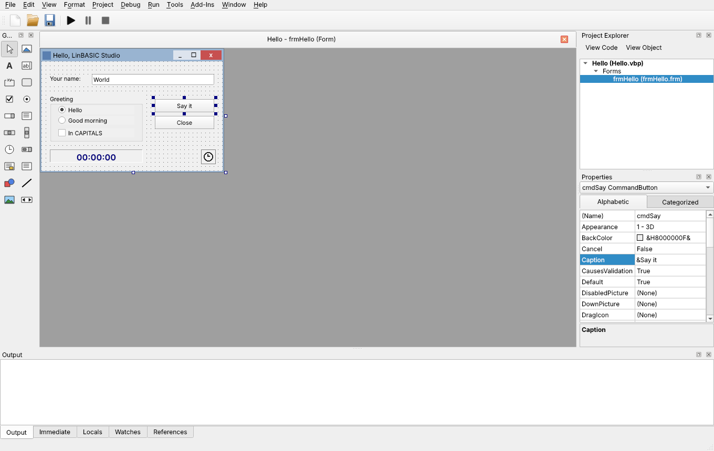

* **`lbvc`, the compiler:** VB6 → C → machine code, with the Tiny C Compiler that comes with
  LinBASIC Studio, so nothing else has to be installed.
* **`libvbrt`, the runtime:** the VB6 language and the VBA library, forms and controls on Qt, the
  controls of the common `.ocx` libraries, DAO and ADO databases, files, printing and multimedia.
* **Windows programs:** the same project becomes a Windows `.exe` (32-bit or 64-bit) that runs on
  Windows 7 to 11 without installing anything.
* **Runs on Windows too:** portable 32-bit and 64-bit editions of the IDE and the compiler for
  Windows 7 or later (see [Windows](#windows)).
* **The IDE:**
  * the form designer, Toolbox, Properties window, Project Explorer and Menu Editor
  * the code window with IntelliSense, the debugger, and refactoring
  * Make for Linux, Windows 32-bit and Windows 64-bit
  * the wizards and add-ins of VB6: Application, Data Form, Data Object, ActiveX Control Interface and
    Property Page Wizards, the Class Builder, the API Viewer, and the Package and Deployment Wizard for
    portable packages (an AppImage, a folder or an archive)
  * F1 help from your own MSDN Library (see [Help](#help): how to copy its files and connect them)

## Contents

* [Screenshots](#screenshots)
* [Download](#download)
* [Quick start](#quick-start)
* [Windows](#windows)
* [Examples](#examples)
* [The IDE](#the-ide)
* [Add-Ins and wizards](#add-ins-and-wizards)
* [The language](#the-language)
* [Forms and controls](#forms-and-controls)
* [Databases](#databases)
* [Windows API](#windows-api)
* [Help](#help)
* [The compiler](#the-compiler)
* [Running compiled programs](#running-compiled-programs)
* [Known differences](#known-differences)
* [Building from source](#building-from-source)
* [How it was reverse engineered (REA)](#how-it-was-reverse-engineered-rea)
* [Layout of the source](#layout-of-the-source)
* [License](#license)

## Screenshots

### The code window

The code window has the Object and Procedure boxes of VB6: choosing an event of a control writes
its procedure, with the parameters from the type library. After a dot, IntelliSense lists the
properties and methods of the object, with Parameter Info and Quick Info as you type.

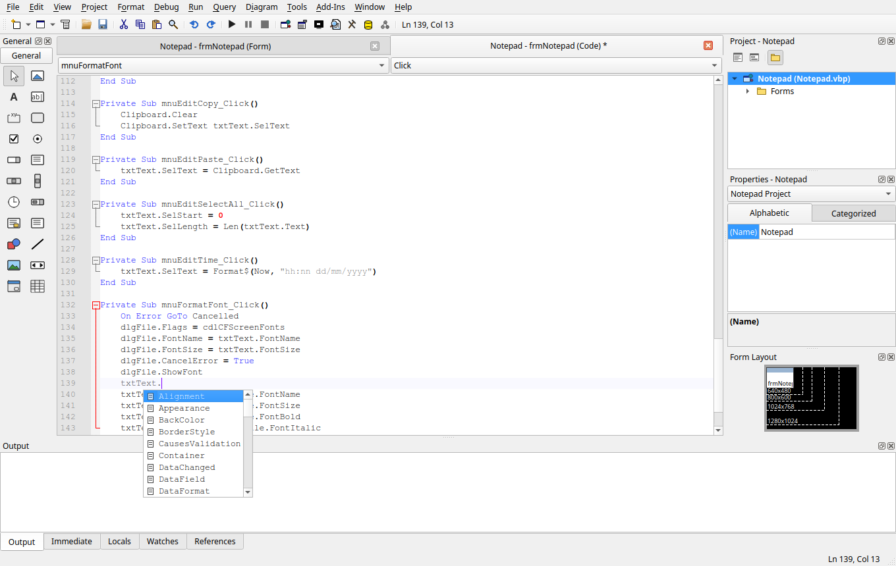

### The debugger

**F5** runs the project under the debugger:

* breakpoints and the yellow line of the next statement
* Step Into, Step Over, Step Out and Run To Cursor
* the Locals, Watches and Call Stack windows
* the Immediate window, for `? expression` and statements in break mode

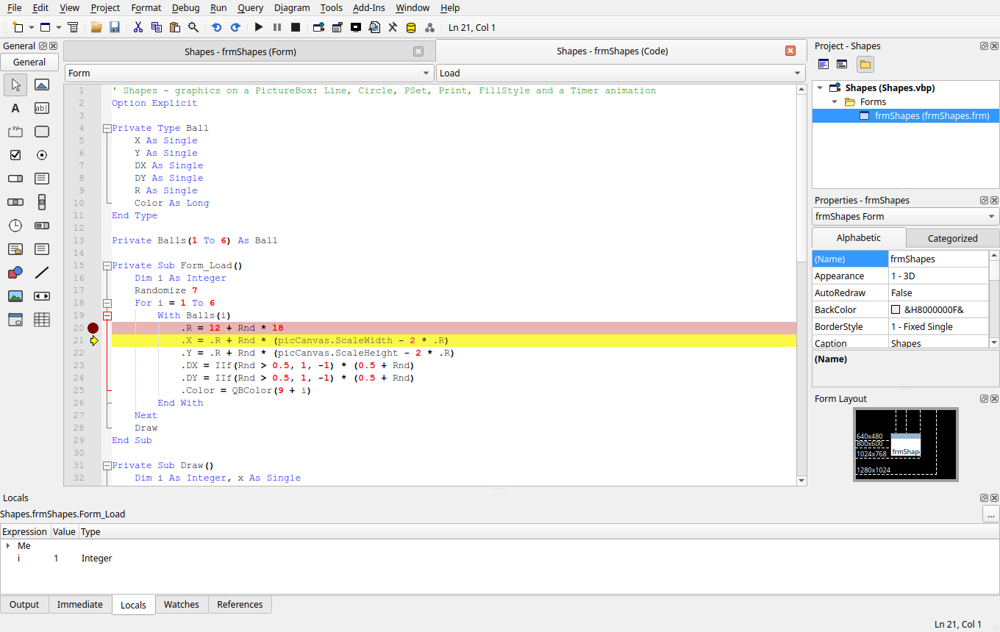

### Controls of the .ocx libraries

Project → Components adds the controls of the common `.ocx` libraries to the Toolbox. The
designer draws them as the program will show them. Below are MSChart and MSFlexGrid.

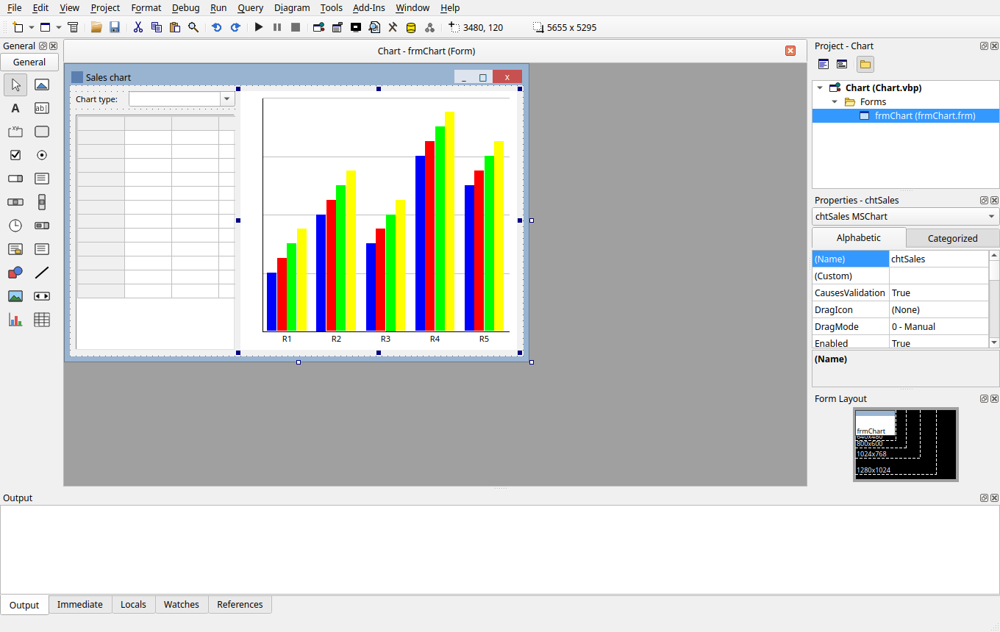

### File → Make

File → Make builds the executable of the project for Linux, Windows 32-bit or Windows 64-bit.

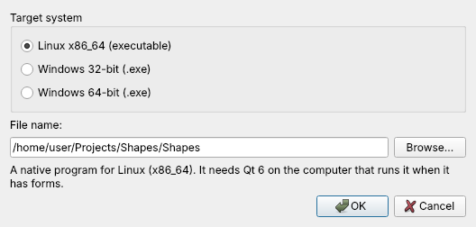

### Programs made with LinBASIC Studio

Each program below is one of the [examples](#examples), compiled with `lbvc` and running on Linux.

**Hello**: a form, its controls (TextBox, Frame, OptionButton array, CheckBox, Timer) and their
events.

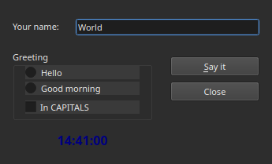

**Notepad**: menus with shortcuts, the CommonDialog control (Open, Save, Font), a multi-line
TextBox and the Clipboard.

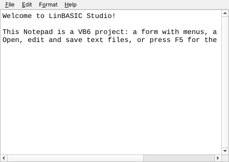

**Shapes**: graphics on a PictureBox (`Line`, `Circle`, `FillStyle`, `Print`) and a Timer
animation of user-defined types.

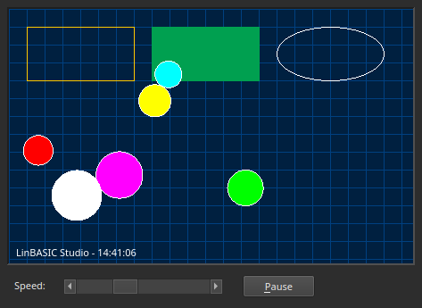

**Explorer**: DriveListBox and DirListBox, and the ListView and StatusBar of the Common Controls.
The files are listed with `Dir$`, `FileLen` and `FileDateTime`.

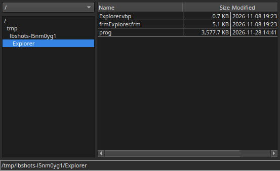

**Chart**: MSFlexGrid and MSChart, with a two-dimensional array as `ChartData`.

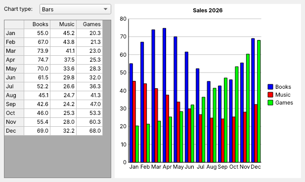

**Address Book**: a DAO database made by the program (`CreateDatabase`, a TableDef, an index),
with a Data control and TextBoxes bound to its fields.

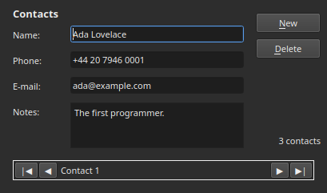

## Download

Every release has a folder `LinBASIC-Studio-<version>` with these files:

| File | Contents |
|---|---|
| `LinBASIC-Studio-<version>-linux-x86_64.zip` | Linux: the AppImage (IDE + compiler + Tiny C Compiler) |
| `LinBASIC-Studio-<version>-win32.zip` | Windows 7 or later, 32- or 64-bit: the portable IDE + compiler |
| `LinBASIC-Studio-<version>-win64.zip` | Windows 7 or later, 64-bit: the portable IDE + compiler |
| `SHA256SUMS` | the checksums of the zips |

Each zip also has `README.md`, `LICENSE` and `licenses/`, the licenses of the third-party software
it carries. The AppImage runs on Ubuntu 24.04 and other current x86-64 Linux distributions:

```sh
unzip LinBASIC-Studio-0.8.0-beta1-linux-x86_64.zip
cd LinBASIC-Studio-0.8.0-beta1-linux-x86_64
chmod +x LinBASIC-Studio-0.8.0-beta1-x86_64.AppImage
./LinBASIC-Studio-0.8.0-beta1-x86_64.AppImage
```

## Quick start

**In the IDE**

1. Start the AppImage, or `LinBASIC Studio.exe` on Windows.
2. Choose **File → Open Project…** and open `examples/Hello/Hello.vbp`, or start a new Standard
   EXE project with **File → New Project**.
3. Press **F5** (*Run → Start*). The project is compiled and runs, and `Debug.Print` writes to the
   Immediate window.
4. To keep the program, choose **File → Make Hello…**, pick the target system and press **OK**.

**On the command line**

```sh
./LinBASIC-Studio-0.8.0-beta1-x86_64.AppImage --lbvc examples/Hello/Hello.vbp -o hello                        # Linux
./hello
./LinBASIC-Studio-0.8.0-beta1-x86_64.AppImage --lbvc examples/Notepad/Notepad.vbp --target win64 -o out/Notepad.exe   # Windows
```

A program with forms gets `libvbforms.so` next to it and uses the Qt 6 of the computer when it runs on
its own (`sudo apt install libqt6widgets6`).

## Windows

The Windows editions are portable. Extract the zip anywhere you can write to, such as your
Documents folder or a USB stick (not *Program Files*), and start `LinBASIC Studio.exe`. Nothing is
installed, and the settings stay in the `settings` folder next to it.

```
LinBASIC-Studio-0.8.0-beta1-win64\
  LinBASIC Studio.exe   the IDE
  lbvc.cmd              the compiler:  lbvc MyProject.vbp -o MyProject.exe
  python\               Python 3.8 with PyQt5 and QScintilla (the IDE)
  ide\, compiler\, data\vb6\
  runtime\              the runtime as DLLs, the Tiny C Compiler, Qt 5 for the forms
  portable.ini          keeps the settings in settings\ (without it: %APPDATA%\linbasic-studio)
```

* The IDE works as on Linux: **F5** runs the program under the debugger, and **File → Make** builds
  a Windows `.exe`. The 32-bit edition makes 32-bit programs, which run on every Windows from 7 on.
  The 64-bit edition makes 64-bit programs.
* A program with forms goes into a folder with the DLLs it needs (`vbrt.dll`, `vbforms.dll`, Qt 5.15).
  The folder runs on Windows 7, 8, 10 and 11 without installing anything.
* On Windows, `Declare` calls the real DLLs (kernel32, user32 and your own, `__stdcall` on 32-bit).
  The code page and the regional settings are those of Windows.
* Windows 7 needs SP1 with the Universal C Runtime update KB2999226, which Windows Update installs.
* Qt 6 needs Windows 10, so the Windows IDE and the Windows programs use Qt 5.15 and Python 3.8, the
  last versions for Windows 7. The IDE is written for PyQt6 and runs on PyQt5 under the names of PyQt6.

## Examples

The [`examples/`](examples) folder has small VB6 projects that show the main parts of LinBASIC
Studio, written in the file format of VB6.

| Project | What it shows |
|---|---|
| [`Hello`](examples/Hello) | a form and its controls: Label, TextBox, CommandButton (Default, Cancel), Frame, an OptionButton array, CheckBox, Timer, MsgBox |
| [`Notepad`](examples/Notepad) | menus and shortcuts, the CommonDialog control, a multi-line TextBox, the Clipboard, text files, `Form_QueryUnload` |
| [`Shapes`](examples/Shapes) | ScaleMode in pixels, `Line` (B, BF), `Circle` (ellipses, fills), `Print`, AutoRedraw, a Timer, a `Type` array and `With` |
| [`Explorer`](examples/Explorer) | DriveListBox, DirListBox, ListView (report view, sorting by column) and StatusBar of MSCOMCTL.OCX, `Dir$` |
| [`Chart`](examples/Chart) | MSFlexGrid and MSChart, `ChartData` from an array, the chart types, a Dropdown List ComboBox |
| [`AddressBook`](examples/AddressBook) | DAO: `CreateDatabase`, TableDef, Index, `Execute`, a Data control, bound TextBoxes, AddNew and Delete |

### Hello, LinBASIC Studio

```vb
Private Sub cmdSay_Click()
    Dim msg As String
    If Trim$(txtName.Text) = "" Then
        MsgBox "Please type your name first.", vbExclamation, App.Title
        txtName.SetFocus
        Exit Sub
    End If
    msg = optGreeting(IIf(optGreeting(0).Value, 0, 1)).Caption & ", " & txtName.Text & "!"
    If chkCapitals.Value = vbChecked Then msg = UCase$(msg)
    MsgBox msg, vbInformation, App.Title
End Sub

Private Sub tmrClock_Timer()
    lblClock.Caption = Format$(Now, "hh:nn:ss")
End Sub
```

### A database made by the program

```vb
Private Sub MakeDatabase(ByVal file As String)
    Dim db As DAO.Database, td As DAO.TableDef
    Set db = DBEngine.Workspaces(0).CreateDatabase(file, dbLangGeneral)
    Set td = db.CreateTableDef("Contacts")
    td.Fields.Append td.CreateField("ID", dbLong)
    td.Fields("ID").Attributes = dbAutoIncrField
    td.Fields.Append td.CreateField("FullName", dbText, 60)
    td.Fields.Append td.CreateField("Phone", dbText, 30)
    db.TableDefs.Append td
    db.Execute "INSERT INTO Contacts (FullName, Phone) VALUES ('Ada Lovelace', '+44 20 7946 0001')"
    db.Close
End Sub
```

Your own VB6 projects should open and compile the same way. Their files are saved in the layout
VB6 writes, so the projects go on working in VB6.

## The IDE

* **Projects:**
  * Standard EXE, ActiveX EXE, ActiveX DLL and ActiveX Control projects, and project groups (`.vbg`)
    with File → Make Project Group
  * Project → References and Components, Add Form / MDI Form / Module / Class / User Control /
    Property Page / Data Environment / Data Report
  * Project → Properties with the General, Make, Compile, Component and Debugging tabs, written to
    the `.vbp` as VB6 writes them
  * the Resource Editor (Add-Ins → Add-In Manager → VB 6 Resource Editor): string tables, bitmaps,
    icons, cursors and custom resources in a `.res` file, byte for byte as VB6 writes it
  * the files are read and written in the layout of VB6: a file you did not change is saved byte
    for byte, in the code page of your system or the one set in Tools → Options
* **The form designer:**
  * the 20 intrinsic controls and those of the `.ocx` libraries; draw a control with the mouse, or
    double-click a tool
  * move and size on the grid, select with a rubber band or Ctrl+click, arrow keys, Cut / Copy /
    Paste (with control arrays) and Undo
  * the Format menu: Align, Make Same Size, Size to Grid, Horizontal / Vertical Spacing, Center
    in Form, Order, Lock Controls; the grid settings in Tools → Options
  * the Form Layout window (StartUpPosition) and the Color Palette
  * the position and size of the selected control in the Standard toolbar
  * double-clicking a control opens the code of its default event
* **The Properties window (F4):**
  * every property of the forms and controls, Alphabetic and Categorized, with the value lists of
    VB6, the Palette / System colors and the Font dialog
  * pictures, lists and long texts go to the `.frx` in the byte layout of VB6
* **The Menu Editor (Ctrl+E):** with the checks of VB6.
* **The code window:**
  * the Object and Procedure boxes, folding, light and dark themes
  * IntelliSense: List Members, Parameter Info, Quick Info, List Constants and Complete Word, with
    the shortcuts of VB6 (Ctrl+J, Ctrl+Shift+J, Ctrl+I, Ctrl+Shift+I, Ctrl+Space)
  * Comment / Uncomment Block, Bookmarks, Window → Split, Insert File, Add Procedure and
    Procedure Attributes
  * File → Print with the options of VB6 (code, Form Image, Form As Text; Print to File as PDF)
* **The Object Browser (F2):** the libraries, classes and members of VB / VBA / VBRUN, of the
  References and Components and of your own project, with Search and View Definition.
* **The debugger:** breakpoints (F9), Step Into (F8), Step Over (Shift+F8), Step Out
  (Ctrl+Shift+F8), Run To Cursor (Ctrl+F8), Set Next Statement (Ctrl+F9), Break (Ctrl+Break),
  Locals, Watches (also Break When Value Is True / Changes), Quick Watch (Shift+F9), Call Stack
  (Ctrl+L), Error Trapping, the values under the mouse and the Immediate window.
* **Refactoring:**
  * Definition (Shift+F2), Last Position (Ctrl+Shift+F2) and Find References (Shift+F12)
  * Rename Symbol (Ctrl+Shift+R): variables, procedures, properties, Types, Enums, controls with
    their event procedures, forms, classes and modules
  * Extract Procedure (Ctrl+Shift+M)
* **The designers of the Data Environment and the Data Report.**
* **Output:** compile errors and run-time errors go to the Output tab at the bottom (with
  Immediate, Locals, Watches and References), and a double click opens the code at the line.
* **The window layout of VB6:** the menus and toolbars (Standard, Edit, Debug, Form Editor) of VB6;
  each tool window has its context menu with Dockable and Hide, and Tools → Options → Docking says
  which ones dock.

## Add-Ins and wizards

Add-Ins → Add-In Manager loads them as in VB6 (Loaded, Load on Startup); each one then has its
command in the Add-Ins menu. Their pages follow VB6's; the code they write, their texts and their
pictures are LinBASIC Studio's own.

* **Application Wizard** (also File → New Project → VB Application Wizard): a new application with an
  MDI, SDI or Explorer main form, its menus, toolbar and status bar, resources, a web browser, the
  standard forms (Splash, Login, Options, About and the form templates) and data forms; profiles
  (`.rwp`) and the Toolbar Wizard.
* **Data Form Wizard:** forms bound to an Access or ODBC database: a single record (ADO code, a
  class or the ADO Data control), a grid, master / detail, an MSHFlexGrid or an MSChart.
* **Class Builder Utility:** the classes and collections of a project with their properties, methods,
  events and enums.
* **ActiveX Control Interface Wizard** and **Property Page Wizard:** the interface of a user control
  (properties, methods, events mapped to its controls) and its property pages.
* **Data Object Wizard:** classes that are a source of data from the commands of a Data Environment,
  and user controls bound to them (single record, ListBox, ComboBox, DataGrid).
* **Package and Deployment Wizard** (and `lbvc --package`): a portable package of the program with
  everything it needs: on Linux an AppImage, a folder or a `.tar.gz`; for Windows a folder or a `.zip`
  (no setup program).
* **API Viewer:** the Constants, Declares and Types of the Windows API for VB6 (32 bits), copied into
  the code (Insert) or to the clipboard. Its database, `LBAPI.TXT` (4342 Declares, 26318 Constants,
  2351 Types), is made by `tools/mkapi.py` from the headers and import libraries of MinGW-w64; the
  status bar tells which procedures the runtime carries out itself on Linux. It also runs on its own:
  `python3 -m lbstudio.apiviewer`.

Not included: the Visual Data Manager (see [Databases](#databases)), the SQL Builder and Data View of
the Visual Database Tools, and add-ins written in VB (VBIDE).

## The language

The whole VB6 language is compiled:

* **Types:**
  * Integer, Long, Single, Double, Currency, Boolean, Byte, Date, String (UTF-16, as in VB6),
    `String * n` and Variant
  * user-defined types (nested, with arrays, `As New`) and Enum
  * fixed and dynamic arrays of all of them (`ReDim Preserve`, `Erase`, `LBound`/`UBound`), arrays as
    values (functions returning arrays, arrays in Variants, `Array`, `Split`, `Join`, `Filter`)
* **Procedures:**
  * Sub, Function and Property Get / Let / Set, with ByRef / ByVal, Optional with defaults
  * named arguments, ParamArray, Static, recursion, GoSub, `On … GoTo`, `AddressOf`
* **Classes:**
  * Class_Initialize / Class_Terminate at the same moment as in VB6 (objects are reference counted)
  * default members, `For Each` over your own collections, the Collection object
  * Implements, Event / RaiseEvent / WithEvents (also of forms and controls)
  * late binding of Object and Variant, `CallByName`, `TypeOf … Is`
* **Errors:** On Error GoTo / Resume / Resume Next, Err.Raise, Err.Number / Description / Source /
  HelpContext, with the error numbers and messages of VB6 (measured on VB6 SP6). Some details:
  * `Error$(n)` and `Err.Raise n` know only the 87 texts of VBA. Other numbers get "Application-defined
    or object-defined error".
  * `Err.Raise 0` (or a number above 65535) is error 5. An HRESULT becomes its VB error (`&H80070005`
    is 70) or "Automation error".
  * An endless recursion is a trappable "Out of stack space" (28).
  * ReDim / Erase of an array whose element was passed ByRef to the running procedure gives error 10.
  * A file already open can be opened again only in the same Input, Binary or Random mode. Kill or Name
    of an open file gives error 55.
* **International text** (measured on VB6 SP6):
  * The ANSI code pages of Windows: 874, 1250–1258, and the double-byte 932, 936, 949 and 950. A
    character a code page does not have becomes its "best fit" (é → e) or `?`.
  * `StrConv(s, conv, LocaleID)` converts through the code page of that locale. vbWide and vbNarrow
    work for Chinese, Japanese and Korean locales, vbKatakana and vbHiragana for Japanese. Elsewhere
    they give error 5, as in VB6.
  * `UCase` / `LCase` change a letter only when the pair goes both ways, as Windows does (ς, ı, İ stay).
  * `StrComp` and `Option Compare Text` compare as Windows does: case, kana and width are ignored, ß =
    ss, accents count only between the same letters, and hyphens count last. `InStr`, `Replace` and
    `Filter` with vbTextCompare ignore case only.
  * `RightToLeft` behaves as on a Windows that is not BiDi: it can be set, and it stays False.
* **Files:** Open for Input / Output / Append / Binary / Random, `Get` / `Put` with the byte layout of
  VB6, `Print #`, `Write #`, `Input #`, `Line Input #`, `Seek`, `Loc`, and FileCopy, Kill, MkDir,
  Dir$, GetAttr / SetAttr, FileDateTime. Paths written with backslashes (`App.Path & "\data.txt"`)
  work on Linux.
* **The VBA library:**
  * the string, math, date and conversion functions; `Format$` with the regional settings; DateAdd,
    DateDiff, DatePart
  * Replace, StrConv, the byte functions (AscB, MidB, InStrB…)
  * the financial functions (Pmt, FV, PV, NPer, IPmt, PPmt), CVErr / IsError
  * Shell, Environ, SendKeys, SaveSetting / GetSetting, and the Scripting runtime (FileSystemObject,
    Dictionary, TextStream)
* **Numbers and dates** behave as in VB6: overflow checks, banker's rounding, and the decimal
  separator and date order of the regional settings (`CStr`, `Print`, `CDate`). `Str`, `Val` and
  `Write #` always use the invariant format.
* **ActiveX components** are compiled into the program that uses them, without COM or registration:
  * ActiveX DLL and EXE projects, with Instancing (including SingleUse and GlobalMultiUse)
  * user controls (`.ctl`) with PropertyBag, Extender and Ambient, and property pages
  * AsyncRead / CancelAsyncRead in user controls, with the events AsyncReadProgress and
    AsyncReadComplete and the AsyncProperty object of VB6 (files, `file:`, `http:`, `https:` and `ftp:`
    addresses, as a file, a byte array or a picture; the status codes of VB6), and UserControl.Hyperlink
    (NavigateTo opens an address in the browser of the system, a file with the program of its type)

## Forms and controls

* **Forms:**
  * Load / Show / Hide / Unload with the events of VB6 in the same order, default instances, the
    Forms and Controls collections
  * MDI forms, several instances of a form, modal forms, PopupMenu
  * the window properties with the frame sizes of Windows 7
* **The intrinsic controls:** CommandButton, Label, TextBox, CheckBox, OptionButton, ListBox,
  ComboBox, Timer, Frame, PictureBox, Image, Shape, Line, the scroll bars, DriveListBox, DirListBox,
  FileListBox, Menu, the Data control.
* **Control behaviour:** control arrays with Load / Unload, `Controls.Add`, keyboard and mouse events,
  focus and Validate, drag and drop, MousePointer, ToolTipText.
* **The help of the programs** (`.chm` and `.hlp` help files): App.HelpFile and HelpContextID (F1 on a
  control, its container, the form, an open menu), What's This (WhatsThisHelp, WhatsThisButton,
  WhatsThisMode, ShowWhatsThis, WhatsThisHelpID, the text pop-ups of `cshelp.txt`), the Help button of
  MsgBox, Err.HelpFile, CommonDialog.ShowHelp. On Linux a help window of the runtime (Contents, Index, Back,
  Print as PDF); on Windows HTML Help. The `.chm` files that chmcmd of Free Pascal 3.2.2 makes are read too.
  The `.hlp` files of WinHelp 3.1 and 4 (all their compressions) are shown on Linux by a reader of the
  runtime, a window as WinHelp 4: Help Topics (Contents of the `.cnt` file, Index, Find), the
  non-scrolling region, jumps and pop-ups, bitmaps and metafiles, the common macros (JumpId, PopupId,
  ExecFile, CreateButton, BrowseButtons …); on Windows by WinHelp, as VB6.
* **Graphics:** `Print`, `Cls`, `PSet`, `Line`, `Circle`, `Point`, `PaintPicture`, Scale and ScaleMode,
  AutoRedraw, the Paint event, LoadPicture / SavePicture, the Screen, Clipboard and App objects.
  The Printer object writes a PDF file.
* **The controls of the `.ocx` libraries**, drawn and run by the runtime itself, with the members,
  events and error numbers of VB6:

| Library | Controls |
|---|---|
| MSCOMCTL.OCX | ImageList, ProgressBar, Slider, StatusBar, Toolbar, TabStrip, TreeView, ListView, ImageCombo |
| MSCOMCT2.OCX | UpDown, DTPicker, MonthView, FlatScrollBar, Animation |
| COMDLG32.OCX | CommonDialog (Open, Save, Color, Font, Help) |
| RICHTX32.OCX | RichTextBox (RTF read and written as VB6 does) |
| MSFLXGRD.OCX, MSHFLXGD.OCX | MSFlexGrid |
| MSCHRT20.OCX | MSChart (bar, line, area, step, pie, XY) |
| TABCTL32.OCX | SSTab |
| PICCLP32.OCX | PictureClip |
| MCI32.OCX | Multimedia control (MMControl) |
| MSCOMM32.OCX | MSComm (the serial ports of the computer) |
| SYSINFO.OCX | SysInfo |
| MSADODC.OCX, MSDATGRD.OCX, MSDATLST.OCX | ADO Data Control, DataGrid, DataList, DataCombo |
| DBGRID32.OCX, DBLIST32.OCX | DBGrid, DBList, DBCombo (bound to the Data control) |
| MSDATREP.OCX | DataRepeater |
| MSRDC20.OCX | RemoteData (RDO) |
| COMCT332.OCX | CoolBar |
| MSMASK32.OCX | Masked Edit (MaskEdBox) |
| MSWINSCK.OCX | Winsock (TCP and UDP) |
| MSINET.OCX | Internet Transfer control (Inet: HTTP, HTTPS, FTP) |
| MSMAPI32.OCX | MAPISession, MAPIMessages (Linux: sends through SMTP / sendmail or the mail program, reads a local Maildir; Windows: the system's Simple MAPI) |

* **Multimedia:** `mciSendString` and the MCI devices waveaudio, sequencer (MIDI), avivideo,
  mpegvideo and cdaudio. On Linux they play through GStreamer.

## Databases

* **DAO 3.51 / 3.6:** DBEngine, Workspace, Database, TableDef, Field, Index, Relation, QueryDef,
  Recordset (Table, Dynaset, Snapshot, ForwardOnly; Seek, Find, Bookmark, transactions), with the
  error numbers of Jet.
* **Jet databases:** an Access 97 / 2000 `.mdb` is imported once into a SQLite file next to it,
  with its tables, indexes, relations and queries. The SQL of Jet is translated to the SQL of
  SQLite.
* **ADO 2.x:**
  * Connection, Recordset (server and client cursors, disconnected and fabricated, Filter, Sort,
    Find, events), Command and Parameters
  * the Jet OLE DB provider, ODBC (MSDASQL: SQL Server, MySQL / MariaDB, PostgreSQL, Oracle, SQLite…
    through unixODBC on Linux and odbc32.dll on Windows) and MSDataShape (hierarchical recordsets)
* **RDO 2.0:** rdoEngine, rdoEnvironment, rdoConnection, rdoQuery, rdoResultset and their
  collections, over the same ODBC drivers, with the error numbers of RDO.
* **Data binding:** the Data control, the ADO Data Control, bound controls and the
  BindingCollection, with the DataFormat of the controls (StdDataFormat: number, currency, date,
  boolean, picture and custom formats, the Format / UnFormat events).
* **Data Environment and Data Report:** commands, hierarchies and aggregates, and the report
  sections. A report can be previewed, printed to PDF, and exported to HTML or text.
* **The database files:** the databases of LinBASIC Studio are SQLite files, also when their name ends
  in `.mdb`; what Jet knows and SQLite does not (the DAO field types, Required, AllowZeroLength,
  validation rules, indexes, relations, queries) is kept in the `MSysLB_*` tables. There is no Visual
  Data Manager: any SQLite tool (for example DB Browser for SQLite) shows and changes the records and
  runs SQL; make the tables with DAO (`CreateTableDef`, `CreateField`, `CreateIndex`) or Jet SQL
  (`CREATE TABLE`, `CREATE INDEX` through `Database.Execute`), so that they have the rules of Jet.

## Windows API

`Declare` statements of the Windows API work on Linux too. Add-Ins → API Viewer gives the `Declare`,
`Const` and `Type` lines of the API (see [Add-Ins and wizards](#add-ins-and-wizards)). The runtime has its own versions of the
procedures that VB6 programs call most. They were chosen from a test run over thousands of Planet
Source Code projects.

* **kernel32:** files and folders, drives and disk space, memory (`CopyMemory`, `GlobalAlloc`), time,
  locale, `GetTickCount`, `Sleep`, processes (`CreateProcess`, `OpenProcess`, `WaitForSingleObject`,
  `GetExitCodeProcess`).
* **advapi32:** the registry, kept in a file.
* **shell32:** `ShellExecute`, the special folders, `SHFileOperation`, `SHBrowseForFolder`,
  `Shell_NotifyIcon` (an icon in the system tray).
* **user32:**
  * `SendMessage` to TextBoxes, ListBoxes, ComboBoxes and buttons
  * `FindWindow`, `Get/SetWindowLong`, `SetWindowPos`, `SetWindowRgn` (forms with a shape),
    `SetLayeredWindowAttributes`, `GetAsyncKeyState`, `GetCursorPos`, `SetTimer`, `CallWindowProc`
* **gdi32:** pens, brushes, fonts, memory DCs with `BitBlt` / `StretchBlt`, `GetDIBits` / `StretchDIBits`,
  regions, `TransparentBlt` and `AlphaBlend`.
* **comdlg32:** `GetOpenFileName`, `GetSaveFileName`, `ChooseColor`.
* **oleaut32:** `SysAllocString`, `SysAllocStringLen`, `SysAllocStringByteLen`, `SysStringLen`,
  `SysStringByteLen`, `SysReAllocString`, `SysFreeString`.
* **Other libraries:** any other library is loaded as a shared object. `VarPtr`, `StrPtr` and
  `ObjPtr` give 32-bit numbers, so they fit in a Long as in VB6.

Strings, Variants and Types are passed as in VB6 (measured on VB6 SP6):

* A String `ByVal` is an ANSI BSTR: the procedure gets its length too, and `vbNullString` is a null pointer.
  A String `ByRef`, including to `As Any`, is the address of an ANSI BSTR. Whatever the procedure leaves
  there comes back as the String.
* `Declare Function ... As String`: the procedure returns a BSTR that holds ANSI bytes. They become the
  characters of the String, and the BSTR is freed. On Linux, a function of a shared object returns a C
  string instead (it is not freed).
* A Variant `ByRef` is a 16-byte VARIANT. A Variant `ByVal` to `As Any` gives error 49 (Bad DLL calling
  convention), as in VB6.
* A Type gets the layout of VB6: ANSI strings, and each field at a multiple of its size, up to 4.
  `LenB` of a Type is its size in memory, with Unicode fixed-length strings.
* `Err.LastDllError` is `GetLastError` right after the call. A call with a String argument (not
  `vbNullString`) or an `As String` result leaves 0 when the procedure does not set an error.
  `Err.Clear` and a missing DLL also leave 0. On Linux, the procedures of the runtime give the Windows
  error codes (2, 3, 5, 80, 183, 203 ...).

## Help

LinBASIC Studio does **not** include any help files: the MSDN Library is Microsoft's work and is
not redistributed. If you own the MSDN Library for Visual Studio 6.0 (October 1998 or later)
legally, LinBASIC Studio can show its VB6 reference from your own copy.

### 1. Get the help files

LinBASIC Studio needs the folder with the `.CHM` help files of VB6 and their `.CHI` index files:
`VB98.CHM`, `VBENLR98.CHM` (the language reference), `VBCON98.CHM` (the programmer's guide), the
help files of the controls (`CMCTL198.CHM`, `MSHFLX98.CHM` …) and a `.CHI` file next to each one.
In the MSDN Library this is the folder `98VS\1033` (`1033` is English; other languages have their
own number). You can take it from any of these places:

* **The MSDN Library CD (disc 1):** copy the folder `98VS\1033` from the CD to your disk.
* **A Windows computer with the MSDN Library installed:** copy the folder
  `C:\Program Files\Microsoft Visual Studio\MSDN98\98VS\1033`. This only works if the Library was
  installed with the *Full* option. A *Typical* installation leaves some files on the CD.
* **A VirtualBox virtual machine with VB6 and the MSDN Library installed** (from Linux):
  `sudo tools/rea/extract-vb6-msdn.sh <disk.vdi> <output folder>` copies, read-only, the MSDN
  Library folder of the machine (the one with the `.CHM` files) to `<output folder>/_MSDN-full`.
  That is the folder to select in step 2. The virtual machine must be powered off, and the script
  needs `sudo apt install qemu-utils ntfs-3g`.

Keep the files in a folder of your own, outside LinBASIC Studio's folders: they are not part of
LinBASIC Studio and must not be given to others.

### 2. Connect them to the IDE

1. Choose **Help → Set Help Folder…** (or **Tools → Options → Environment**, **MSDN Library (your own copy)**, **…**).
2. Select the folder with the `.CHM` and `.CHI` files (the `1033` folder). Only a folder with
   `.CHM` files is accepted.
3. LinBASIC Studio remembers the folder.

To read the `.CHM` files, LinBASIC Studio unpacks each one the first time it is used, into
`~/.cache/linbasic-studio/msdn` on Linux (`settings\cache\msdn` in the portable Windows edition).
The original files are only read, never changed. The unpacking needs one of these tools:

* **Linux:** `sudo apt install libchm-bin` (`extract_chmLib`) or `sudo apt install p7zip-full` (`7z`).
* **Windows:** 7-Zip if it is installed, otherwise `hh.exe -decompile`, which Windows already has.

### 3. Use it

F1 opens the topic of the word under the caret in the code window, of a property in the Properties
window, or of the selected control in the designer. The topic is found through the help context
numbers of the type libraries, as VB6 does. **Help → Contents**, **Index** and **Search** open the
help window of the MSDN Library: the table of contents (Visual Basic Documentation, Data Access,
Books), the keyword index, full-text search (AND / OR / NOT / NEAR, titles only, similar words,
search within the previous results), Locate, Previous / Next, Back / Forward and Print. The pages are
always shown black on white, also with the dark theme. Without a folder set, F1 and the Help menu
offer **Set Help Folder…**.

## The compiler

```
lbvc [options] PROJECT.vbp | MODULE.bas ...
  -o FILE          the executable (a Windows program: FILE.exe, with its DLLs next to it)
  --target linux|win32|win64
                   the system of the executable (default: the system lbvc runs on)
  --check          check the syntax and the types only
  --debug          with the hooks of the debugger of LinBASIC Studio
  -C               write the generated C and stop
  --codepage CP    the code page of the source files (default cp1252; the IDE uses the system's)
  --order MODE[,overflow][,bounds][,flpoint][,unrounded]
                   the code of VB6 to follow: pcode, fast, small or noopt, with Remove Integer
                   Overflow / Array Bounds / Floating Point Error Checks and Allow Unrounded
                   Floating Point Operations (default: the Compile settings of the .vbp; pcode
                   for .bas files)
  --ide            a run as the IDE makes it (Run, F5): the order of P-code, and Debug.Print
                   (a made program has no Debug.Print, as in VB6: its arguments are not evaluated)
```

* In the AppImage it runs as `LinBASIC-Studio-…AppImage --lbvc …`, and on Windows as `lbvc.cmd …`.
* Errors use the `file:line:col: error: message` format, with the messages of VB6 ("Variable not
  defined", "Method or data member not found", "Type mismatch"…).
* **Order of evaluation:** VB6 does not always evaluate an expression from left to right, and the order
  depends on how it compiles (in `a + f() * g()` the calls can come in either order). lbvc follows the
  same order as VB6: Run (F5) in the IDE uses the order of the VB6 IDE (P-Code), and Make uses the order
  of the code chosen in Project Properties (P-Code or Native Code; Fast, Small or No Optimization;
  Remove Integer Overflow Checks and Remove Array Bounds Checks). The rules were measured on VB6 SP6
  (`tests/order`, `compiler/lbvc/evalorder.py`).
* **Checks and precision:** as in VB6, Single and Double expressions are computed in extended precision
  (80 bits) and rounded when a value is stored, passed or compared; a floating-point error stores its
  result (Inf, NaN) before it is raised. The advanced options of the Compile settings work as in VB6:
  Remove Integer Overflow Checks (integers wrap around), Remove Array Bounds Checks, Remove Floating
  Point Error Checks (1.#INF, -1.#IND), Allow Unrounded Floating Point Operations (`tests/checks`).
  A Windows program built by the Tiny C Compiler on Windows has no extended precision (its long
  double is a double).

**How a program is built:**

* **Linux:** with the bundled Tiny C Compiler, or with gcc when `CC=gcc` is set, as in a source tree.
* **Windows, on Windows:** with the bundled Tiny C Compiler.
* **Windows, on Linux:** with mingw-w64 (`sudo apt install mingw-w64`).
* **The runtime:** only the libraries a program uses are linked into it — `libvbrt` always,
  `libvbforms` for forms, `libvbdb` for databases.

## Running compiled programs

| Variable | Effect |
|---|---|
| `VBRT_LCID=1033` | the regional settings (1033 English US, 1032 Greek…; default: `LANG`) |
| `VBRT_CODEPAGE=1253` | the ANSI code page of `Asc`, `Chr` and the files |
| `VBRT_PRINTER_FILE=file.pdf` | where the Printer object and the reports print (default `<program>-printer.pdf`) |
| `VBRT_COM1=/dev/ttyUSB0` | the device of a serial port of MSComm |
| `VBRT_NO_ERRBOX=1` | an unhandled run-time error is written to stderr instead of a message box |
| `VBRT_MONKEY=1` | the test robot: clicks every button, option, list and menu item and reports every run-time error |
| `VBRT_SCREENSHOT=file.png` | a picture of the forms after `VBRT_SCREENSHOT_DELAY` ms (default 1500), then the end |

`python3 tests/samples/run_samples.py <folder> <out folder>` runs the robot over every Standard EXE
project under a folder (the samples of your VB6, for example), on a virtual screen. It reports
each project as OK, ERR, COMPILE, HANG or EXIT, with the run-time errors and pictures of the forms;
for a HANG it also says in which procedure and line the program was. The robot answers Yes to every
question, and some programs delete or install things, so every program runs inside bubblewrap
(`sudo apt install bubblewrap`): the disk is read-only for it except its own folder, and it has no
network and no access to your desktop session or your screen.

## Known differences

* **Not available:**
  * the OLE container control, Excel / Word automation and MSMQ
  * DirectX, the Winsock control, the Script control and DDE (the Link properties do nothing)
  * a bridge to the real COM objects of Windows
* **Win32 API:** a window of another program cannot be found or changed on Linux. `FindWindow`
  finds the program's own forms.
* **Help:** on Linux the `.hlp` files are shown by the reader of the runtime: the files of WinHelp 3.0
  (1990) are not read, annotations and the hotspots of `.shg` pictures are not supported, and the macros
  that the reader does not know are ignored. CommonDialog.ShowHelp opens a `.chm` file (VB6 calls WinHelp,
  which cannot).
  On Linux the **?** of the title bar (WhatsThisButton) is there only if the window manager draws it;
  Shift+F1 and WhatsThisMode do the same.
* **Decimal:** there is no Decimal Variant: `CDec` and the `adNumeric` fields of ADO give a Double.
* **The byte functions** (`MidB`, `InStrB`…) work on whole characters (two bytes each).
* **MSChart** starts with its default settings: VB6 keeps a chart's settings in a binary block of
  the `.frx`, which is not read. The program sets the chart up.
* **Reports** follow the fonts of the computer, so an exported report has the text of VB6's but
  not always its page breaks.
* **Not supported by the database runtime:** the crosstab queries (`TRANSFORM … PIVOT`) and DBGrid /
  DBList / DBCombo (the DAO controls of VB5).

## Building from source

On Ubuntu 24.04:

```sh
sudo apt install build-essential qt6-base-dev python3-pyqt6 python3-pyqt6.qsci zip
sh runtime/build.sh            # runtime/libvbrt.a
sh runtime/db/build.sh         # runtime/libvbdb.a (SQLite, libmdb)
sh runtime/forms/build.sh      # runtime/forms/libvbforms.a and libvbforms.so (Qt 6)
python3 compiler/lbvc.py examples/Hello/Hello.vbp -o hello
ide/run.sh examples/Hello/Hello.vbp            # the IDE from the source tree
```

* **The AppImage:** `packaging/build-tcc-linux.sh` builds the Tiny C Compiler for Linux, then
  `packaging/build-appimage.sh` builds the AppImage.
* **The runtime for Windows** (`sudo apt install mingw-w64`), for `win64` and `win32`:
  1. `packaging/build-qt-windows.sh win64` builds Qt 5.15 with mingw-w64.
  2. `packaging/build-tcc.sh` builds the Tiny C Compiler for Windows.
  3. `runtime/build-win.sh win64`, `runtime/db/build-win.sh win64` and
     `runtime/forms/build-win.sh win64` build the libraries.
  4. `runtime/build-dll-win.sh win64` builds the DLLs.
* **The portable Windows editions:**
  `packaging/make-win.py win64 python-3.8.10-embed-amd64.zip out/` (and the same for `win32`).
* **A release:** `packaging/make-release.sh <version> <AppImage> <win32 folder> <win64 folder>`
  makes the release folder with one zip per system.
* **The pictures of this README:** `docs/screenshots/make_screenshots.py`.

**Tests:** each folder of `tests/` has a `run_tests.py`.

* `lang` (the language, 23 tests), `forms` (11), `db` (databases), `comp` (ActiveX components),
  `designer` (forms made by the designer, compared byte for byte with the same forms saved by VB6),
  `dev` (MCI, MSComm, SysInfo), `debugger` and `ide`.
* The language, forms, database and component tests compare the output of each program, byte for
  byte, with the output of the same program compiled by VB6.
* `LBVC_TARGET=win64` runs them as Windows programs in Wine.

## How it was reverse engineered (REA)

* **The VB6 IDE** (VB6.EXE): the menus, toolbars, dialogs and shortcuts.
* **The type libraries** of VBA, VB, VBRUN, stdole and the `.ocx` controls, read by
  `compiler/lbvc/typelib.py`: every object, member, constant, parameter and help context.
  `data/vb6` has them as JSON.
* **MSVBVM60.DLL:** the run-time error numbers and messages, and the behaviour of the language. It
  was checked with VB6-compiled probe programs whose output is kept in `tests/*/expected`. This
  covers:
  * the order of the events of forms and controls
  * number and date formatting with the regional settings
  * the `Get` / `Put` record layout
  * the rounding and overflow rules
* **The file formats:**
  * `.vbp`, `.vbg`, `.frm`, `.ctl`, `.pag`, `.dsr`
  * the binary `.frx` (pictures, lists, long texts) and the `.dsx` of the Data Report
  * all of them are written back as VB6 writes them, checked byte for byte
* **The Planet Source Code corpus:** a robot run over thousands of VB6 projects, to find what real
  programs use.
* See [the feature map](docs/rea/vb6-feature-map.md).

## Layout of the source

```
compiler/lbvc/     the compiler: lexer, parser, code generator, driver; project/ (the VB6 file
                   formats), typelib.py (COM type libraries)
runtime/           the runtime (C): libvbrt (language, VBA, files, Declare and the Windows API,
                   Scripting, MCI, MSComm, the debugger's end), forms/ (libvbforms, C++ and Qt: forms,
                   controls, .ocx controls, user controls, Data Report, the GUI Windows API, the
                   help of the programs with CHMLib in forms/chm and the .hlp reader forms/hlp.inc),
                   db/ (libvbdb: DAO, ADO, ODBC, data binding, SQLite, libmdb)
ide/lbstudio/      the IDE (Python, PyQt6 + QScintilla; the editor of Linpad++)
data/vb6/          the VB6 object model recovered by REA (type libraries, IDE menus, error messages)
examples/          the example projects (see Examples above)
tests/             the tests, compared with VB6
tools/rea/         the REA tools
tools/mkapi.py     the database of the API Viewer (ide/lbstudio/data/api/LBAPI.TXT) from MinGW-w64
packaging/         the AppImage, the Tiny C Compiler, the Windows editions, the releases
licenses/          the licenses of the third-party software
docs/              the feature map and the pictures of this README
```

## License

LinBASIC Studio is free software under the **GNU General Public License v3.0 or later** (see
`LICENSE`).

**Your programs are yours.** The runtime that goes into every program you compile (libvbrt,
libvbforms, libvbdb) is under the GPL with the **LinBASIC Studio Runtime Library Exception**
(`RUNTIME-EXCEPTION`), in the spirit of the GCC Runtime Library Exception: you may give your
compiled programs to others under any license you choose, open or closed source, without
publishing their source. Only changes to the runtime itself must stay open (GPL). The IDE and the
compiler are GPL without the exception.

The third-party software LinBASIC Studio carries, with its licenses, is listed in
[licenses/](licenses/README.md):

* the Tiny C Compiler, SQLite and libmdb of MDB Tools
* Python, Qt, PyQt and QScintilla
* the editor of Linpad++

A program that uses DAO or ADO contains libmdb (LGPL-2.0-or-later). If you give such a program to
others, give them, or offer, the C source of your program (`lbvc -C`) or its object files, so that
they can link it again with a changed libmdb.

LinBASIC Studio is an independent project. It is not affiliated with or endorsed by Microsoft, and it
contains no VB6 or other Microsoft program, type library, help or documentation file. The
`.mdb` files and the DAO / Jet DLLs of VB6 are not part of it either. The Windows editions include
only the redistributable runtime DLLs that come with Python and Qt.
Microsoft, Visual Basic and Windows are trademarks of Microsoft Corporation.
